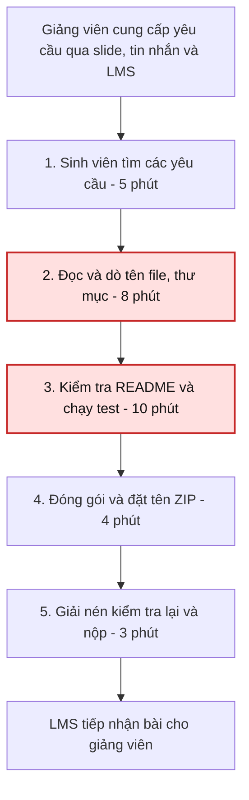

# CP5 — Quy trình hiện tại

Nguồn: mục 4.1 của [báo cáo nhóm](../team/group_report.md). Các số phút được giữ theo bản nhóm cung cấp; chưa có nhật ký bấm giờ đi kèm. Tổng 5 + 8 + 10 + 4 + 3 = 30 phút. Hai bước 2–3 cộng 18 phút, không phải riêng bước 3 mất 18 phút.

**Chú giải:** đỏ đánh dấu hai bước được báo cáo là bottleneck. Handoff đầu vào: giảng viên → sinh viên; handoff đầu ra: sinh viên → LMS/giảng viên. Tác vụ 1–5 đều do sinh viên thao tác.

| Bước | Input | Output |
|---|---|---|
| 1 | Các thông báo/slide của môn | Tập yêu cầu cần rà |
| 2 | Yêu cầu + cây thư mục | Danh sách tên/đường dẫn cần sửa |
| 3 | README, mã nguồn, lệnh test | Kết quả kiểm tra hướng dẫn và test |
| 4 | Thư mục bài làm | File ZIP có tên theo yêu cầu |
| 5 | ZIP, hướng dẫn nộp | Bài gửi và xác nhận tiếp nhận |

**Giới hạn phép so sánh:** bước 3 chứa chạy test code, nhưng sơ đồ tương lai chỉ kiểm quy cách. Không được suy ra giảm 80% cho cùng công việc trước khi tách thời gian chạy test và đo lại hai quy trình cùng phạm vi.
