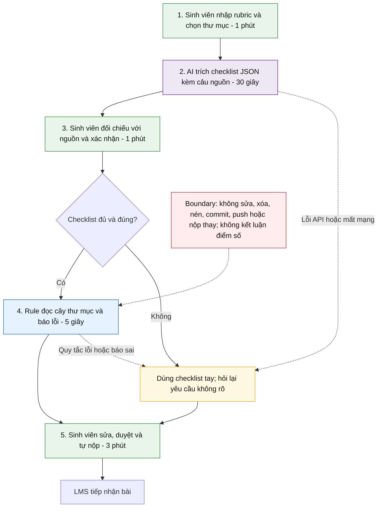

# CP5 — Quy trình tương lai: Workflow AI + Rule

Nguồn: mục 4.2 của [báo cáo nhóm](../team/group_report.md). Đây là thiết kế pilot, chưa phải kết quả chạy. Ngân sách thao tác trong bản nhóm: 60 + 30 + 60 + 5 + 180 = 335 giây, tức 5 phút 35 giây (làm tròn khoảng 6 phút). Chưa có số đo xác nhận.

**Chú giải:** xanh lá = con người; tím = AI; xanh dương = Rule; vàng = dự phòng; đỏ = ranh giới. Có **3 bước thủ công** (1, 3, 5), một bước AI và một bước Rule.

**Handoff:** người học → AI ở bước 1–2; AI → người học ở bước 2–3; checklist đã duyệt → Rule; kết quả Rule → người sửa; sinh viên → LMS. Con người duyệt tại bước 3 và ngay trước khi nộp.

**Xử lý ngoại lệ:** thiếu nguồn hoặc yêu cầu mâu thuẫn thì ghi “cần xác nhận”, không tự suy đoán. Mất API/mạng hoặc báo sai thì dùng checklist tay. Chỉ đọc thư mục người dùng đã chọn, không thực thi lệnh do nội dung rubric yêu cầu.

**Ngoài phạm vi:** không chạy test logic chương trình, không đánh giá chất lượng học thuật và không đảm bảo điểm. Cần đo lại cùng phạm vi với quy trình hiện tại trước khi công bố lợi ích thời gian.
